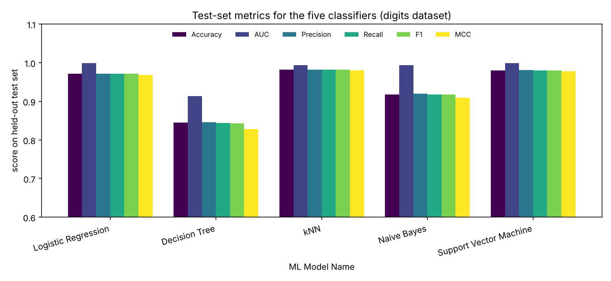

# Handwritten Digit Recognition - Five Classifiers, One Streamlit App

Machine Learning - Assignment 2 | M.Tech (DSE), BITS Pilani WILP

## a. Problem statement

Given a small 8x8 image of a handwritten digit, predict which digit (0-9) it shows. This is a **10-class classification** problem. The goal of this assignment is to implement five classical classifiers (Logistic Regression, Decision Tree, k-Nearest Neighbours, Gaussian Naive Bayes and Support Vector Machine) on one dataset, evaluate them with six metrics (Accuracy, AUC, Precision, Recall, F1, MCC), and demonstrate them in an interactive Streamlit web application deployed on Streamlit Community Cloud.

## b. Dataset description

| Property | Value |
|---|---|
| Name | Optical Recognition of Handwritten Digits (optdigits) |
| Source | UCI Machine Learning Repository, dataset id 80 (Alpaydin & Kaynak, 1998), licence CC BY 4.0 |
| Citation | Alpaydin, E. & Kaynak, C. (1998). Optical Recognition of Handwritten Digits [Dataset]. UCI Machine Learning Repository. https://doi.org/10.24432/C50P49 |
| Part used | The 1,797-image optdigits test file (this is the copy distributed with scikit-learn as `load_digits`); the full UCI dataset has 5,620 images |
| Instances | 1,797 (minimum required: 500) |
| Features | 64 (minimum required: 12) - integer pixel counts, range 0 to 16, named `pixel_0_0` ... `pixel_7_7` |
| Target | `target` - the digit class 0 to 9 |
| Problem type | Multi-class classification, 10 balanced classes (174 to 183 images per digit) |
| Missing values | None |
| Origin of features | NIST preprocessing: each 32x32 binary bitmap is split into non-overlapping 4x4 blocks and the "on" pixels in each block are counted, giving an 8x8 grid of values 0 to 16 |
| Writers | 13 people wrote the digits in this test file |

**Train / test split.** 75 % / 25 % stratified split with `random_state=2026`: 1,347 training images (`data/train_data.csv`) and 450 held-out test images (`test_data.csv`). Every number reported below is measured on the 450 held-out images; the training images are used only for fitting and for 5-fold cross-validated hyper-parameter search.

**Pre-processing.** Logistic Regression, kNN and SVM are trained inside a scikit-learn `Pipeline` with a `StandardScaler`, so scaling statistics are learnt on training folds only. Decision Tree and Gaussian Naive Bayes do not need scaling. Three pixels (`pixel_0_0`, `pixel_4_0`, `pixel_4_7`) are constant zero in every image; they carry no information, are standardised safely by `StandardScaler`, and are why Gaussian Naive Bayes needs a variance-smoothing term.

**Metric definitions for a 10-class problem.** Precision, Recall and F1 are **macro-averaged** (each digit has equal weight). AUC is **one-vs-rest, macro-averaged**, computed from `predict_proba`. MCC is the multi-class Matthews correlation coefficient from scikit-learn.

## c. GitHub repository link

https://github.com/nitunkp/digit-classifier-streamlit 

Live Streamlit app: https://digit-classifier-nkp.streamlit.app 

### Repository structure

```
digit-classifier-streamlit/
|-- app.py                       Streamlit application
|-- requirements.txt
|-- README.md
|-- test_data.csv                450 held-out images used for all results (upload this in the app)
|-- data/
|   |-- digits_full.csv          complete 1,797-image dataset
|   `-- train_data.csv           1,347 training images
|-- model/
|   |-- model_definitions.py     the five pipelines and their hyper-parameter grids
|   |-- evaluation.py            the six metrics, confusion matrix, classification report
|   |-- train_models.py          split, tune, evaluate, save (python -m model.train_models)
|   |-- *.joblib                 one saved, fitted pipeline per model
|   |-- best_params.json         parameters chosen by cross-validation
|   |-- feature_columns.json
|   `-- metrics_summary.csv      the comparison table below, with extra columns
`-- assets/metrics_comparison.png
```


## d. Models used

All five models were trained on the same 1,347 training images. For each model the hyper-parameters were chosen by 5-fold stratified cross-validation (grid search, macro-F1) on the training images only. Results are on the 450 held-out test images.

### Comparison table

| ML Model Name | Accuracy | AUC | Precision | Recall | F1 | MCC |
|---|---|---|---|---|---|---|
| Logistic Regression | 0.9711 | 0.9987 | 0.9717 | 0.9711 | 0.9713 | 0.9679 |
| Decision Tree | 0.8444 | 0.9134 | 0.8456 | 0.8440 | 0.8430 | 0.8276 |
| kNN | 0.9822 | 0.9940 | 0.9825 | 0.9820 | 0.9820 | 0.9803 |
| Naive Bayes | 0.9178 | 0.9933 | 0.9202 | 0.9173 | 0.9174 | 0.9090 |
| Support Vector Machine | 0.9800 | 0.9992 | 0.9808 | 0.9800 | 0.9801 | 0.9779 |

Chosen hyper-parameters: Logistic Regression C=1; Decision Tree gini, max_depth=14, min_samples_leaf=1; kNN k=5 with distance weighting; Naive Bayes var_smoothing=0.1; SVM RBF kernel with C=10, gamma=0.001.



### Observations on model performance

| ML Model Name | Observation about model performance |
|---|---|
| Logistic Regression | Strong for a linear model: 437 of 450 test images correct (accuracy 0.9711, MCC 0.9679) and an AUC of 0.9987, second only to the SVM. It fits the training data almost perfectly (99.85 % accuracy), so the gap to test accuracy is small. Digits 8 and 5 are its weakest classes (recall about 0.93). It is very fast to train and easy to interpret, but it cannot bend its decision boundary around the odd shapes that kNN and the RBF-SVM capture. |
| Decision Tree | The weakest model by a wide margin: accuracy 0.8444, F1 0.8430, MCC 0.8276 and the lowest AUC (0.9134). It memorises the training set (100 % training accuracy against 84 % on test), so it is clearly over-fitted even after tuning. Axis-aligned splits on single pixel counts are a poor fit for image data where the information lies in combinations of neighbouring pixels. Digit 8 is hit hardest (recall 0.674, often predicted as 1 or 3). The low AUC also reflects its coarse, almost 0/1 leaf probabilities. |
| kNN | Best accuracy, F1 and MCC on the test set (0.9822, 0.9820, 0.9803) with only 8 errors out of 450. Similar digits written by different people lie close together in the standardised 64-dimensional space, so a distance-weighted vote of 5 neighbours works very well. Its AUC (0.9940) is lower than LR and SVM because neighbour votes give coarse probabilities. Its training accuracy of 100 % is not informative (with distance weighting every training point is its own nearest neighbour). Prediction needs the whole training set, which is acceptable here but would not scale well. |
| Naive Bayes | Accuracy 0.9178, F1 0.9174, MCC 0.9090: clearly behind the three strongest models but far ahead of the tree. The independence assumption is violated because neighbouring pixels are strongly correlated, and pixel counts bounded between 0 and 16 are not Gaussian. Its AUC (0.9933) is nevertheless high, meaning it ranks the right digit near the top but its hard decisions are often wrong, mainly for 8 (recall 0.791), 9 (0.844) and 1 (0.848). A large var_smoothing of 0.1 was selected, which stabilises the variance of the near-constant edge pixels. It is the fastest model to train. |
| Support Vector Machine | Near-perfect ranking and classification: best AUC (0.9992), accuracy 0.9800 (441 of 450 correct), F1 0.9801, MCC 0.9779 and the highest cross-validated macro-F1 on the training data (0.9806). Training accuracy is 99.3 %, so its generalisation gap is the smallest of the strong models. The RBF kernel captures non-linear class boundaries while the margin and C=10 keep it regularised. Remaining errors are spread thinly (5 mistaken as 9, 8 mistaken as 1, two each). It is the slowest to tune because probability estimates need an internal cross-validation. |
| **Overall winner for this dataset** | **Support Vector Machine (RBF kernel).** It has the best AUC and the best cross-validation score, and its test accuracy is within one image of kNN (441 vs 442 correct out of 450), a difference that is well inside the noise of a 450-image test set. kNN has the highest raw test numbers, so the top two are practically tied; the SVM is preferred because its performance is consistent across cross-validation, test accuracy and AUC, and because it is far cheaper than kNN at prediction time on larger data. |

## Streamlit application

The app (`app.py`) provides:

1. **Dataset upload (CSV)** - sidebar uploader for a test CSV with the 64 pixel columns and an optional `target` column. Until a file is uploaded, all six metrics show 0.0000; they update only after a test CSV is uploaded.. Files with missing columns or non-numeric pixels produce a clear message instead of an error.
2. **Model selection dropdown** - choose any of the five classifiers.
3. **Evaluation metrics** - Accuracy, AUC, Precision, Recall, F1 and MCC for the selected model, shown as metric tiles.
4. **Confusion matrix and classification report** - heat-map plus per-digit precision/recall/F1 table.

Extra tabs: a gallery of the digits the selected model got wrong (drawn as 8x8 images), a side-by-side comparison of all five models on the data in use, and a predictions table with CSV download. Saved models are loaded from `model/*.joblib`; if a file cannot be loaded on the server (for example a different scikit-learn version) the model is re-fitted automatically from `data/train_data.csv`.

## Limitations

- A random split puts digits from the same writers in both training and test sets; a writer-independent split (train on some writers, test on others, as the original UCI files do) would give lower, more realistic scores.
- Differences of one or two images between the top models are not statistically meaningful on a 450-image test set.
- Images are only 8x8, which limits the information available to every model.

## Deployment (Streamlit Community Cloud)

Deployed at streamlit.io using this repo from GitHub. 
